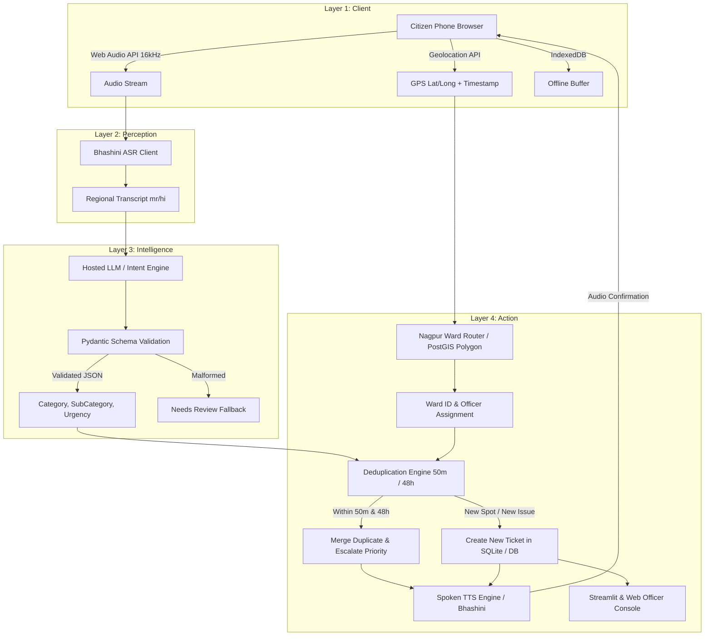

# Jan-Vani: System Architecture & Social Impact Analysis
**Theme: AI for Social Impact | Reference: SIH26038 Problem Framing**
**College: St. Vincent Pallotti College of Engineering and Technology, Nagpur**

---

## 1. Problem Statement Alignment (Section 1.1 & 5.1)
Rural and semi-urban citizens face insurmountable friction with existing e-governance grievance portals:
1. **Language Barrier:** Government portals require formal English or Sanskritized Hindi typing.
2. **Device & UI Complexity:** Multi-step menus, mandatory dropdowns (Ward No., Department, Sub-category), CAPTCHAs, and OTPs.
3. **Black-Hole Feedback:** Citizens receive a numeric ticket ID via SMS without vernacular status updates.
4. **Duplicate & Unlocated Tickets:** Municipal ward officers are overwhelmed by 50+ fragmented complaints for the exact same burst pipe on a single street.

---

## 2. Before vs After Comparison (Presentation Slide)

```
┌──────────────────────────────────────────────────────────────┐
│  OLD CIVIC PORTAL WORKFLOW (5 Frustrating Steps)             │
├──────────────────────────────────────────────────────────────┤
│  [Step 1] Download heavy app or open English website        │
│  [Step 2] Enter mobile number, wait for OTP SMS             │
│  [Step 3] Manually find Zone, Ward Number, Sub-Department   │
│  [Step 4] Type detailed complaint in English or Hindi       │
│  [Step 5] Receive silent ticket ID #849202 with no updates  │
│                                                              │
│  RESULT: 70%+ drop-off among semi-literate citizens;         │
│          Officers receive duplicate & unlocated tickets.     │
└──────────────────────────────────────────────────────────────┘
                              VS
┌──────────────────────────────────────────────────────────────┐
│  JAN-VANI WORKFLOW (1 Seamless Tap)                          │
├──────────────────────────────────────────────────────────────┤
│  [Tap Mic] Citizen speaks naturally in Marathi or Hindi      │
│  [Instant Ack] "तक्रार प्राप्त झाली" plays on phone speaker │
│  [Silent AI] ASR transcribes -> LLM validates Pydantic schema│
│  [Spatial] GPS locates Nagpur Ward polygon automatically     │
│  [Dedupe] 50m / 48h complaints merged -> Priority escalated  │
│  [Spoken TTS] Citizen hears verbal confirmation in Marathi!  │
│                                                              │
│  RESULT: 100% voice accessibility; Zero typing required;     │
│          Officers get unified, prioritized ticket dossiers.  │
└──────────────────────────────────────────────────────────────┘
```

---

## 3. Four-Layer System Architecture



---

## 4. Ward Boundary Definition (Nagpur Municipal Corporation)
The system incorporates Nagpur Municipal Corporation's administrative ward boundaries:
- **Ward 1:** Laxmi Nagar (Zone 1)
- **Ward 2:** Dharampeth (Zone 2)
- **Ward 3:** Hanuman Nagar (Zone 3)
- **Ward 4:** Dhantoli (Zone 4)
- **Ward 5:** Nehru Nagar (Zone 5)
- **Ward 6:** Gandhibagh (Zone 6)
- **Ward 7:** Satranjipura (Zone 7)
- **Ward 8:** Lakadganj (Zone 8)
- **Ward 9:** Ashi Nagar (Zone 9)
- **Ward 10:** Mangalwari (Zone 10)
